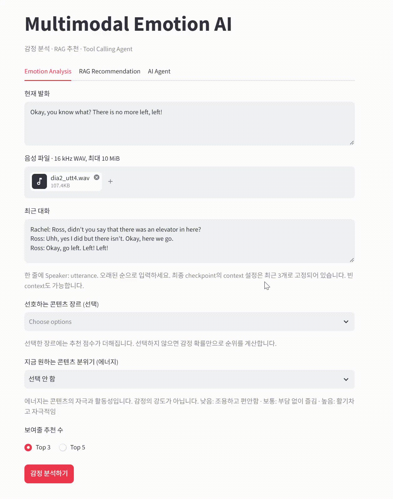
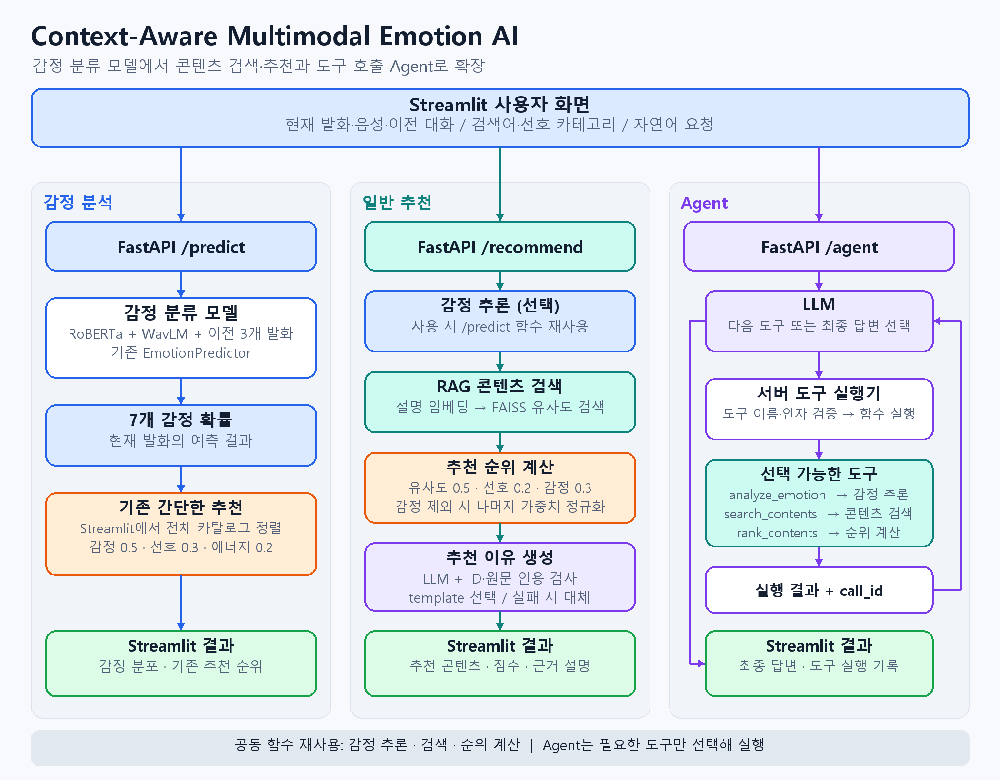

# Context-Aware Multimodal Emotion AI

MELD 대화 데이터를 대상으로 현재 발화의 텍스트와 음성, 이전 대화 문맥을 결합해 7개 감정을 분류한 모델입니다.
텍스트·음성·문맥 결합 모델을 비교하고, 입력이 훼손된 상황에서 성능 변화를 확인했습니다.
학습한 모델의 감정 예측을 RAG 콘텐츠 검색·추천과 연결하고, LLM 추천 이유 생성과 Agent를 Streamlit 화면에서 확인할 수 있도록 확장했습니다.



## Highlights

- **Text baseline:** RoBERTa 기반 텍스트 분류
- **Audio baseline:** WavLM 기반 음성 분류
- **Audio-text fusion:** 텍스트와 음성에서 추출한 특징 벡터를 하나로 합쳐 감정 분류
- **Context fusion:** 동일 대화의 이전 최대 3개 turn을 추가 입력으로 사용
- **Robustness & error analysis:** 텍스트 일부 단어 제거, 음성 노이즈 추가 상황에서 성능 변화 확인
- **RAG · Recommendation:** 콘텐츠 임베딩으로 유사한 항목을 검색하고, 유사도·사용자 선호·감정 확률로 추천 순위 계산
- **LLM · Agent:** 검색 근거를 이용한 추천 이유 생성과 사용자 요청에 따른 도구 선택·실행
- **Streamlit demo:** 감정 분류와 기존 간단한 추천, RAG 추천, Agent를 세 탭에서 확인

## Demo flow

**일반 추천 — `POST /recommend`**

```text
Streamlit: 검색어 + 선호 카테고리 (+ 선택: 현재 발화·16 kHz WAV·이전 대화)
  → FastAPI: 감정 사용 시 /predict 함수 재사용 → 7개 감정 확률
  → RAG 콘텐츠 검색 → 유사도·선호도·감정 확률로 순위 계산
  → LLM 추천 이유 생성 또는 template 설명 → Streamlit 결과 표시
```

감정 활용을 끄면 감정 추론을 생략합니다.

**Agent — `POST /agent`**

```text
Streamlit: 자연어 요청 + 선호 카테고리 (+ 선택: 감정 분석 입력)
  → FastAPI: LLM에 요청과 도구 목록 전달
  → LLM이 필요한 도구 선택 → 서버에서 실행
  → 실제 도구 실행 결과를 LLM에 전달
  → 추가 도구 선택 또는 최종 응답 → Streamlit 답변·도구 실행 기록 표시
```

기존 **Emotion Analysis** 탭도 유지했습니다. `/predict`의 감정 확률을 받아 전체 가상 카탈로그에
`0.5 × 감정 일치 + 0.3 × 선호 일치 + 0.2 × 원하는 에너지 일치`를 적용합니다.
이 계산은 새 RAG 추천의 점수식과 다르며, 검색과 LLM을 사용하지 않습니다.

## Model architecture


현재 발화의 텍스트, 현재 음성, 이전 3개 발화 문맥에서 각각 768차원 표현을 추출합니다. 세 표현을 2,304차원으로 연결한 뒤 Dropout과 Linear layer를 거쳐 7개 감정 logits를 출력합니다. 현재 텍스트와 문맥은 같은 RoBERTa encoder를 공유합니다.

## System architecture



## Context window study: 1 vs 3 vs 5 turns

주요 확인 사항은 **현재 발화를 해석할 때 과거 대화를 몇 turn까지 사용하는 것이 적절한가**였습니다. 나머지 모델 구조와 학습 조건을 유지하고 최근 1개, 3개, 5개 발화를 각각 입력해 비교했습니다.

| Previous context | Dev Macro F1 |
|---:|---:|
| 1 turn | 0.453938 |
| **3 turns** | **0.465442** |
| 5 turns | 0.465110 |

> 문맥 길이는 검증 데이터의 Macro F1만으로 선택했으며, 가장 높은 3 turns를 최종 설정으로 사용했습니다.

## Final evaluation snapshot

손상된 음성에 해당하는 발화 2개를 제외한 공통 Test 데이터 2,608개로 평가했으며, Macro F1을 주 지표로 사용했습니다.

| Model | Clean Macro F1 | Accuracy |
|---|---:|---:|
| Text only | 0.4521 | 0.6518 |
| Audio only | 0.2983 | 0.4762 |
| Audio-text fusion | **0.4587** | 0.6311 |
| Context fusion (3 turns) | 0.4379 | 0.6300 |

텍스트·음성 결합 모델은 텍스트 단독보다 Macro F1은 높았지만 Accuracy는 낮았습니다. 문맥과 음성의 효과는 샘플별로 달랐습니다.

### 모델 비교에서 추가로 확인한 내용

기존 성능표의 텍스트·음성 결합 모델은 텍스트 단독보다 Macro F1이 **0.006559 높고**, Accuracy는 **0.020706 낮았습니다**. 문맥 모델은 테스트 성능이 개선되지 않았습니다. 텍스트에서 결합으로 바뀌며 오답을 맞힌 경우는 126개, 정답을 틀린 경우는 180개였고, 결합에 문맥을 추가했을 때는 각각 197개와 200개였습니다.

단어 제거는 현재 발화에만 적용하고 과거 대화는 유지했습니다. 단어 제거 확률 0.3에서 Macro F1 감소량은 텍스트 0.069677, 결합 0.047749, 문맥 0.040266이었습니다.

음성에 잡음을 추가했을 때 성능 변화는 크지 않았습니다. 이번 실험에서는 음성 모델의 성능을 별도로 개선하기보다 잡음에 따른 예측 성능 변화를 확인하는 데 중점을 두었습니다.

이전 발화 1개, 3개, 5개를 비교한 결과, Dev 데이터에서 성능이 가장 높았던 3개를 최종 설정으로 선택했습니다. 이후 해당 설정으로 학습한 모델을 Test 데이터에서 평가했습니다.

모델별 학습 설정에는 일부 차이가 있었으며, 이번 프로젝트에서는 텍스트·음성·융합 모델을 구현하고 성능을 비교하는 데 중점을 두었습니다.

## RAG · LLM · Agent

### RAG 및 추천

콘텐츠는 [`demo/data/demo_contents.csv`](demo/data/demo_contents.csv)에 정의한 **가상 콘텐츠 15개**입니다.
음악·코미디·동기부여·휴식·드라마 카테고리에 제목, 설명, 감정 태그, 에너지를 지정했습니다.
실제 콘텐츠 서비스나 재생 링크를 연결하지 않았습니다.

| 구현 | 방식 |
|---|---|
| 임베딩 | `sentence-transformers/paraphrase-multilingual-MiniLM-L12-v2`로 콘텐츠 설명과 검색어를 같은 공간에 임베딩 |
| 검색 | L2 정규화한 벡터를 FAISS `IndexFlatIP`로 검색. 내적을 cosine similarity로 사용 |
| 재사용 | 최초 검색 시 콘텐츠 임베딩과 인덱스를 메모리에 만들고, 같은 서버 프로세스에서 재사용 |
| 순위 계산 | 검색 후보 안에서 유사도·선호도·감정 점수를 가중합. 기본 후보 10개 중 상위 3개 반환 |

[`rag/ranking.py`](rag/ranking.py)의 점수식은 다음과 같습니다.

```text
S = (cosine similarity + 1) / 2
P = 콘텐츠 카테고리가 선호 목록에 있으면 1, 아니면 0
E = 콘텐츠 감정 태그에 해당하는 7개 예측 확률의 합 (중복 태그 제외)

감정 포함: score = 0.5 × S + 0.2 × P + 0.3 × E
감정 제외: score = (0.5 × S + 0.2 × P) / 0.7  (감정 가중치 0)
```

추천 순위는 콘텐츠 유사도, 사용자 선호도, 감정 분석 결과를 가중합하여 계산합니다. 선호 카테고리를 선택하지 않으면 선호도 점수는 0으로 처리하며, 각 항목이 최종 점수에 얼마나 반영됐는지도 확인할 수 있습니다.

별도의 추천 모델을 학습하지 않고, 세 가지 기준을 조합한 규칙 기반 추천 방식을 사용했습니다.

### LLM 추천 이유 생성

[LLM](rag/explanation.py)은 검색된 콘텐츠를 바탕으로 한국어 추천 이유를 생성합니다. 생성된 결과의 콘텐츠 ID와 인용 문구를 검사하며, 오류가 발생하면 미리 작성된 추천 설명을 사용합니다.

<a id="single-agent-데이터-흐름과-function-calling"></a>

### LLM Agent

[LLM Agent](rag/agent.py)는 사용자 요청에 따라 감정 분석, 콘텐츠 검색, 추천 순위 계산 도구를 선택하고 실행합니다. 도구 실행 결과를 확인한 뒤 추가 도구를 사용하거나 최종 답변을 생성합니다.

일반 추천은 미리 정의된 흐름에 따라 실행되지만, Agent는 요청에 따라 필요한 기능만 사용할 수 있습니다.

추천에 사용하는 콘텐츠 후보와 감정 확률은 서버에서 관리하며, LLM이 임의로 생성한 값이 추천 순위 계산에 사용되지 않도록 구성했습니다.

| 도구 | 실행 내용과 조건 |
|---|---|
| `search_contents` | 설명 임베딩·FAISS 검색. 후보와 요청 내 `search_id` 반환, 1~10개 검색 |
| `rank_contents` | 해당 요청에서 검색한 `search_id`의 후보만 사용. 서버가 보관한 선호·감정 확률로 상위 1~5개 계산 |
| `analyze_emotion` | 첨부한 현재 발화·음성·이전 대화를 기존 `/predict` 함수에 전달. 현재 발화와 음성을 함께 제공해야 실행 가능 |

### 추천 순위 산정의 평가

동일한 검색 후보 10개에서 감정 항만 제외·추가하고 최종 3개를 비교했습니다. 실제 임베딩 모델과 FAISS를 사용했으며, **8개 시나리오의 감정 확률·관련도는 수작업 합성 값**입니다.

| 지표 | 감정 제외 | 감정 포함 |
|---|---:|---:|
| NDCG@3 | 0.919289 | 0.934733 |
| Recall@3 | 0.760417 | 0.729167 |
| MRR@3 | 1.000000 | 1.000000 |


## Repository layout

```text
.
├── api/                            # FastAPI /predict 및 추천·Agent 라우터 연결
├── demo/                           # Streamlit 세 탭, HTTP 클라이언트, 기존 추천
│   └── data/demo_contents.csv      # 가상 콘텐츠 15개
├── src/                            # 멀티모달 모델·전처리·감정 추론
├── rag/                            # 검색·순위 계산·LLM 설명·Agent와 API
├── notebooks/                      # 텍스트·음성·결합·문맥 실험
├── analysis/                       # 강건성·오류 분석 실행 코드
├── assets/                         # 모델·시스템 구성도, 실험 이미지, 데모 GIF
└── requirements-rag.txt            # 기존 requirements.txt와 검색·LLM 의존성
```

## Figures

| 모델별 Macro F1 비교 | 음성 노이즈에 따른 성능 변화 |
|---|---|
|  |  |

| 텍스트 단어 제거에 따른 성능 변화 | 음성·문맥 추가 후 예측 변화 |
|---|---|
|  |  |

| 예측이 개선·악화된 샘플의 confidence 변화 | Confidence-bin analysis |
|---|---|
|  |  |

## Reproducibility notes and limitations

### 실행 조건

- 감정 분석 기능을 실행하려면 학습된 모델 가중치와 입력 전처리 파일이 필요합니다. 해당 파일의 저장 경로는 `EMOTION_CHECKPOINT`, `EMOTION_ASSETS` 환경변수로 지정합니다.
- 검색에는 임베딩 모델이 필요합니다. 기본 모델은 `EMBEDDING_MODEL`로 바꾸고 `EMBEDDING_REVISION`으로 버전을 고정할 수 있습니다. 최초 다운로드에는 인터넷 연결이 필요하며, 모델이 로컬에 준비되어 있으면 감정을 끈 `template` 추천은 외부 LLM API 없이 실행할 수 있습니다.
- LLM 추천 이유와 Agent에는 서버 셸의 `OPENAI_API_KEY`·`OPENAI_MODEL`이 필요합니다. `.env`는 자동으로 읽지 않습니다. Agent는 LLM 없이 실행할 수 없습니다.
- Streamlit 서버 주소는 `EMOTION_API_URL`로 설정합니다. `/health`는 감정 모델 상태만 보여주므로 검색이나 LLM 준비 상태는 별도로 확인해야 합니다.


### 실험과 추천의 한계

- Context는 같은 dialogue의 **이전** turn만 사용하고 최대 3개 turn으로 제한했습니다.
- 텍스트 입력이 불완전한 상황을 보기 위해 일부 단어를 임의로 제거했고(word dropout), 음성에는 Gaussian noise를 추가해 입력이 훼손된 상황에서 성능이 얼마나 떨어지는지 확인했습니다.
- MELD 데이터로 학습했으며, 일반적인 대화에서도 같은 성능이 나오는지는 확인하지 않았습니다. 소수 클래스에 대한 분석도 충분하지 않습니다.
- 여러 seed로 반복 실험하거나 통계적 유의성을 검정하지 않았습니다.
- 콘텐츠 태그와 추천 가중치는 직접 정했습니다. 실제 사용자 선호를 학습하거나 사용자 만족도·감정 변화를 평가하지 않았습니다. 앞의 감정 분류 성능표는 추천 품질 평가와 별개입니다.
- Agent 도구 실행 성공은 답변 내용의 정확성을 보장하지 않습니다. 답변·설명 전체의 사실성은 정량 평가하지 않았습니다.


## Data and attribution

감정 분류 실험에는 [MELD](https://affective-meld.github.io/) 데이터셋을 사용했습니다.
텍스트 분석에는 RoBERTa, 음성 분석에는 WavLM을 사용했으며, 콘텐츠 검색에는 Sentence Transformer 기반 임베딩을 활용했습니다.

추천 기능에 사용한 콘텐츠 카탈로그는 데모를 위해 구성한 가상 데이터입니다.
