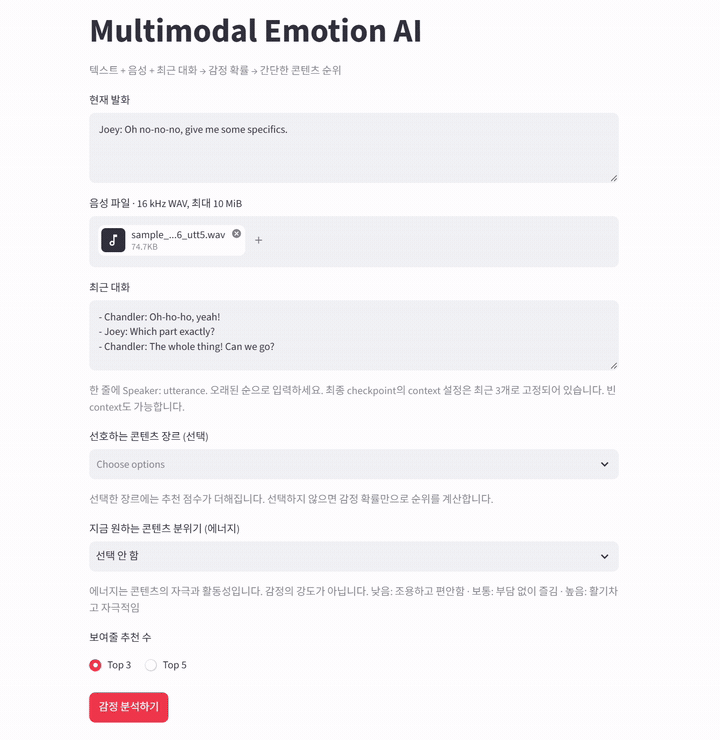
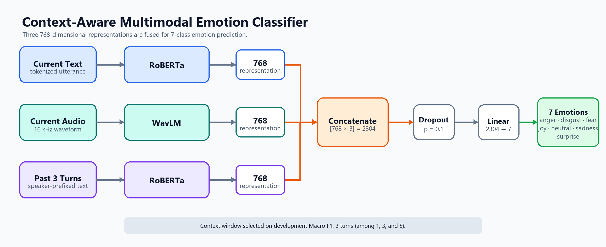
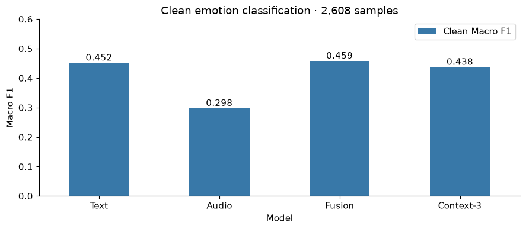
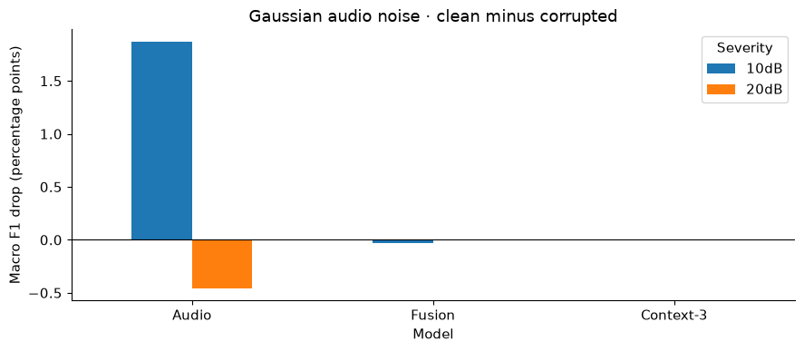
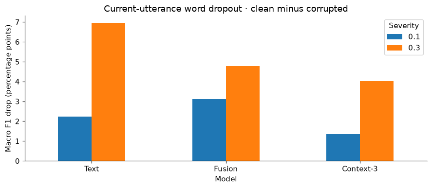
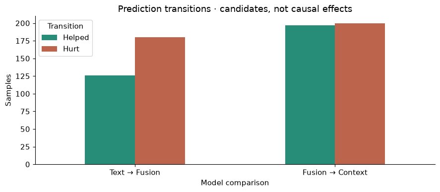
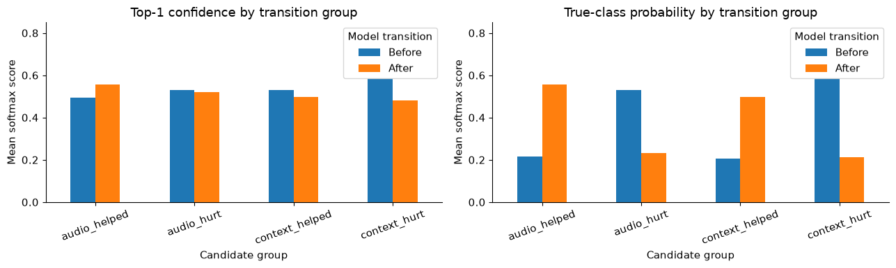
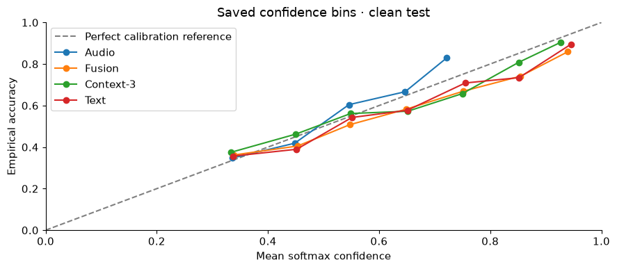

# Context-Aware Multimodal Emotion AI

MELD 대화 데이터를 대상으로 현재 발화의 텍스트와 음성, 이전 대화 문맥을 결합해 7개 감정을 분류한 모델입니다.
실제 동작을 확인할 수 있도록 생성형 AI를 이용하여 간단한 데모까지 연결했습니다.




## Highlights

- **Text baseline:** RoBERTa 기반 텍스트 분류
- **Audio baseline:** WavLM 기반 음성 분류
- **Audio-text fusion:** 텍스트 음성 추출한 특징 벡터를 하나로 합쳐 감정 분류
- **Context fusion:** 동일 대화의 이전 최대 3개 turn을 추가 입력으로 사용
- **Application demo:** 학습된 모델의 감정 예측 결과를 확인하고, 사용자 선호를 반영한 간단한 콘텐츠 순위까지 연결
- **Robustness & error analysis:** 텍스트 일부 단어 제거, 음성 노이즈 추가 상황에서 성능 변화 확인

## Demo flow

```text
Current text + 16 kHz WAV + previous 3 turns
                         ↓
              FastAPI /predict
                         ↓
       7-class emotion probabilities
                         ↓
  0.5 × emotion match + 0.3 × preference + 0.2 × energy
                         ↓
        Streamlit Top-3 / Top-5 ranking
```

추천 weight는 학습으로 최적화한 값이 아닌 데모용 heuristic입니다. 추천 결과와 점수는 실제 콘텐츠나 추천 성공 확률을 의미하지 않습니다.

> 모델 checkpoint와 tokenizer/processor 자산은 저장소에 포함하지 않습니다. API와 inference 코드는 구현을 보여주기 위한 참고용이며, clone한 저장소만으로 실제 감정 추론을 실행할 수 없습니다.

## Model architecture



현재 발화의 텍스트, 현재 음성, 이전 3개 발화 문맥에서 각각 768차원 표현을 추출합니다. 세 표현을 2,304차원으로 연결한 뒤 Dropout과 Linear layer를 거쳐 7개 감정 logits를 출력합니다. 현재 텍스트와 문맥은 같은 RoBERTa encoder를 공유합니다.

## Context window study: 1 vs 3 vs 5 turns

핵심 연구 질문은 **현재 발화를 해석할 때 과거 대화를 몇 turn까지 사용하는 것이 적절한가**였습니다. 나머지 모델 구조와 학습 조건을 유지하고 최근 1개, 3개, 5개 발화를 각각 입력해 비교했습니다.

| Previous context | Dev Macro F1 |
|---:|---:|
| 1 turn | 0.453938 |
| **3 turns** | **0.465442** |
| 5 turns | 0.465110 |

> Context length는 development set의 Macro F1만으로 선택했으며, 가장 높은 3 turns를 최종 설정으로 사용했습니다.

## Final evaluation snapshot

공통 test set 2,608개 샘플(음성이 누락된 2개 발화 제외) 기준이며 Macro F1을 주 지표로 사용했습니다.

| Model | Clean Macro F1 | Accuracy |
|---|---:|---:|
| Text only | 0.4521 | 0.6518 |
| Audio only | 0.2983 | 0.4762 |
| Audio-text fusion | **0.4587** | 0.6311 |
| Context fusion (3 turns) | 0.4379 | 0.6300 |

Fusion은 text-only보다 Macro F1은 높았지만 Accuracy는 낮았습니다. Context와 audio의 효과는 샘플별로 달랐습니다.

## Repository layout

```text
.
├── api/                            # FastAPI inference service
├── demo/                           # 한글 Streamlit UI, ranking, synthetic catalog
├── src/                            # multimodal inference 구현
├── notebooks/                      # 단계별 실험 및 설명
├── analysis/                       # robustness / error-analysis runners
└── assets/                         # README figures 및 demo GIF
```

## Figures

| 모델별 Macro F1 비교 | 음성 노이즈에 따른 성능 변화 |
|---|---|
|  |  |

| 텍스트 단어 제거에 따른 성능 변화 | AUdio Context 추가 후 예측 변화 |
|---|---|
|  |  |

| 예측이 개선 악화된 샘플의 confidence 변화 | Confidence-bin analysis |
|---|---|
|  |  |

## Reproducibility notes and limitations

- Context는 같은 dialogue의 **이전** turn만 사용하고 최대 3개 turn으로 제한했습니다.
- 텍스트 입력이 불완전한 상황을 보기 위해 일부 단어를 임의로 제거했고(word dropout), 음성에는 Gaussian noise를 추가해 입력이 훼손된 상황에서 성능이 얼마나 떨어지는지 확인했습니다.
- 소수 클래스와 MELD의 드라마 대화 domain 밖의 일반화는 검증하지 않았습니다.
- seed 반복 및 통계적 유의성 검정을 수행하지 않았습니다.
- 콘텐츠 순위는 별도로 학습한 추천 모델이 아니라, 감정 예측 결과의 활용 예시를 보여주기 위해 만든 간단한 규칙 기반 기능입니다.

## Data and attribution

Dataset은 [MELD](https://affective-meld.github.io/)의 사용 조건을 따릅니다. 모델 구성에는 RoBERTa와 WavLM 계열을 사용했습니다. 전체 MELD 데이터, 음성 자료, tokenizer/processor 자산과 모델 가중치는 저장소에 포함하지 않습니다.
